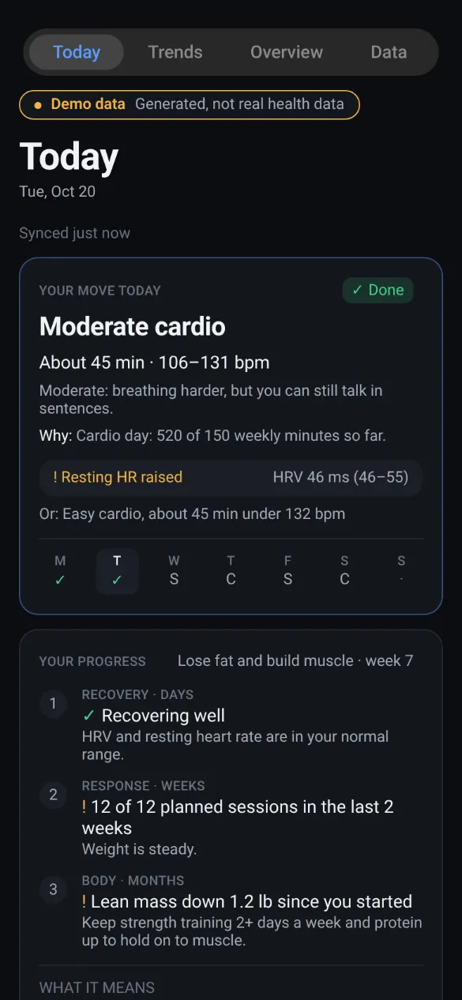
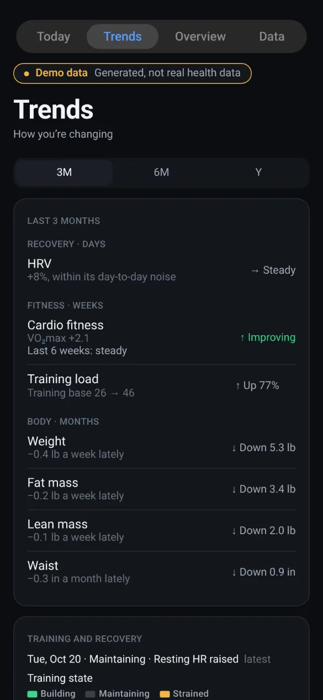
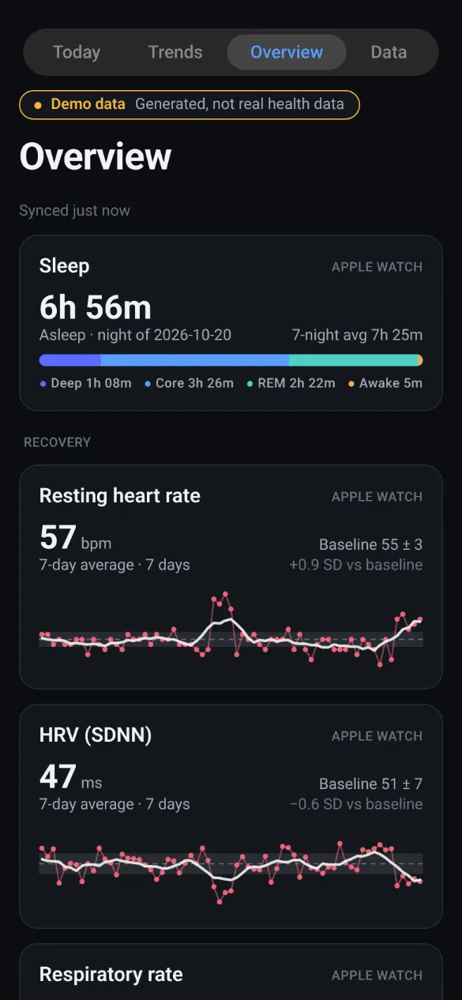
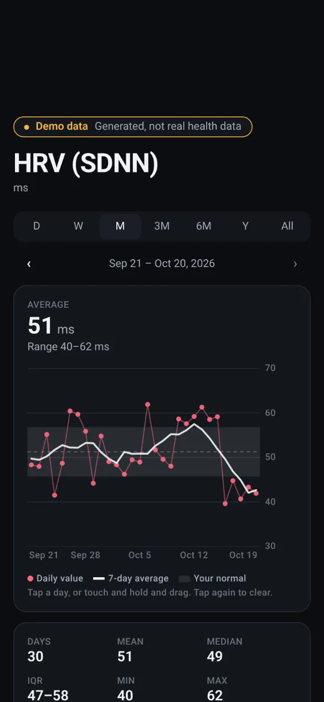
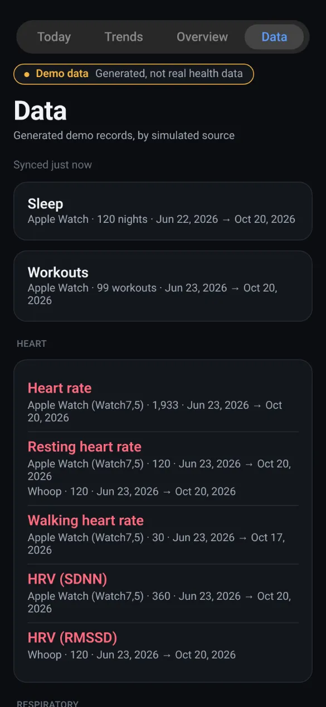

# Ultra Health

A personal health-analytics app that turns wearable data (Apple Watch, Whoop, smart scale)
into interpretable, evidence-based trends. It judges every metric against **your own
baseline**, keeps **device provenance** on every reading, and never blends measurements that
aren't comparable.

> **Status:** early-stage personal project under active development. It runs on iOS as a
> personal-device build (installed from Xcode with a developer account). It is **not on the
> App Store**, there is no TestFlight, and APIs, screens and the database schema still change.
>
> **Not medical advice.** Ultra Health is not a medical device and is not intended to
> diagnose, treat or prevent any condition. Talk to a clinician about anything that worries
> you.

## Screenshots

All values below are **generated demo data**, not anyone's health records (note the "Demo
data" pill on every screen). They are the real app screens and analytics, rendered in a
browser through react-native-web from a seeded synthetic dataset, and captured automatically
with `pnpm --filter @ultra-health/mobile screenshots`.

|                                                                             Today                                                                              |                                                                 Trends                                                                  |                                                                       Overview                                                                       |                                                                HRV detail                                                                 |                                                                   Data                                                                    |
| :------------------------------------------------------------------------------------------------------------------------------------------------------------: | :-------------------------------------------------------------------------------------------------------------------------------------: | :--------------------------------------------------------------------------------------------------------------------------------------------------: | :---------------------------------------------------------------------------------------------------------------------------------------: | :---------------------------------------------------------------------------------------------------------------------------------------: |
|  |  |  |  |  |

What they do and don't show:

- **Dark mode only.** The app ships dark-only today (see [ROADMAP.md](ROADMAP.md)).
- **The web tab bar differs from iOS.** On iOS the tabs are native and sit at the bottom, and
  include Settings. Native sheets, haptics and HealthKit permission prompts don't exist on
  the web build.
- The dataset is 120 days from three simulated sources (Apple Watch, Whoop, a smart scale,
  plus manual tape measurements), with a simulated illness, a week without weigh-ins, a few
  short nights and a hard training block in the last five days. That is why Today says
  "Resting HR raised".

## Repository layout

```
apps/mobile/        Expo (SDK 57) iOS app: HealthKit ingest, encrypted local store, UI
packages/core/      Platform-agnostic domain model: metric catalog, source provenance,
                    DST-safe local dates, statistics, baseline comparison
legacy/web-prototype/  Original Next.js viewer for the Health XML export (archived)
data/               Local-only personal exports (git-ignored, never commit)
```

`packages/core` has no React Native dependency. The same code will run the analytics
research against the full XML export in Node, and later on a server.

## Architecture

```
HealthKit ──► HealthDataSource (port) ──► SyncEngine ──► SQLCipher DB ──► read models ──► UI
              healthkit.ts adapter        anchored,       writer conn     queries.ts      TanStack
              (Health Connect / Whoop     resumable,      + read-only                     Query
               adapters plug in here)     per-stream      reader conn
```

**Ingest strategy per metric** (declared in `packages/core/src/metrics/catalog.ts`):

| Strategy           | Used for                                             | Why                                                                               |
| ------------------ | ---------------------------------------------------- | --------------------------------------------------------------------------------- |
| `samples`          | HR, HRV, RHR, VO₂max, SpO₂, resp. rate, temp, weight | Keeps every reading with its source, so series are never mixed across devices.    |
| `daily_statistics` | Steps, energy, distance, exercise/stand, daylight    | HealthKit de-duplicates iPhone + Watch overlap only inside its statistics engine. |

**Sync guarantees** (`apps/mobile/src/sync/engine.ts`):

- Anchored queries pick up inserts and deletions incrementally.
- Each page of data commits in the same transaction as its anchor. A crash mid-backfill
  resumes exactly where it stopped, with no gaps or duplicates.
- Streams are isolated: a failing type is recorded and the rest continue.
- Daily aggregates re-fetch a trailing 14 days to absorb late uploads.

**Data-integrity rules**

- Sample series are drawn from **one source kind** at a time (`apple_watch`, `whoop`,
  `smart_scale`, …). Apple Watch HRV is SDNN from ~1-minute daytime readings, while Whoop
  reports RMSSD during sleep. Mixing them silently would produce a meaningless series.
- Implausible values (outside hard physiological bounds) are kept for audit but excluded
  from analysis. The Data tab shows how many were excluded per source.
- Days without data are gaps, never zeros, and charts don't bridge gaps longer than 3 days.
- Sleep is attributed to the wake-up day. Overlapping segments are unioned, not summed.

## Security & privacy

- **Local-first.** Nothing leaves the device and there are no analytics SDKs. That is the
  simplest way to meet HIPAA-grade expectations and App Store Guideline 5.1.3.
- **Encrypted at rest.** The database is SQLCipher (AES-256) with a random 256-bit key in the
  Keychain (`AFTER_FIRST_UNLOCK_THIS_DEVICE_ONLY`). Backups contain only ciphertext. If the
  key is lost, the store is rebuilt from HealthKit.
- **Read-only HealthKit access** in production builds. Only the `development` variant can
  write, and only synthetic data to the Simulator.
- **Separate reader connection** (`query_only`) for the UI. **Privacy-safe logging**: values
  are never logged (`src/logger.ts`).
- Only whitelisted scalar metadata is stored (motion context, VO₂ test type, algorithm
  version, time zone).
- **No personal data in this repository.** Health exports, back-test output and snapshots
  live in the git-ignored `data/` directory and are never committed. Test fixtures are
  synthetic. CI runs a gitleaks secret scan on every push and pull request.

## Getting started

Requirements: Node 22.12+ (`nvm use`), pnpm 10, Xcode 26 with the iOS platform installed
(Xcode › Settings › Components), and CocoaPods.

```bash
pnpm install
pnpm check                       # prettier + typecheck + lint + tests
```

### Demo mode (no iPhone, no HealthKit)

A deterministic synthetic dataset (`apps/mobile/src/demo/generate.ts`, seeded RNG) drives a
demo mode that needs no HealthKit and no personal data. It runs the real pipeline: in-memory
SQLite, the sync engine, the analytics and the charts. Every screen shows a "Demo data" pill.

```bash
cd apps/mobile
pnpm web                                         # dev server in the browser, demo mode
EXPO_PUBLIC_DEMO_DATE=2026-10-20 pnpm web:export  # static build in dist-web/ (fixed "today")
```

Setting `EXPO_PUBLIC_DEMO=1` for a native development build should also switch to demo
mode, but so far demo mode has only been exercised on the web. The web build is a development
and review aid, not a supported product. To regenerate the
screenshots, install Playwright once (`npx playwright install chromium`, plus the package in
any directory you point `PLAYWRIGHT_MODULE` at) and run:

```bash
EXPO_PUBLIC_DEMO_DATE=2026-10-20 pnpm web:export
PLAYWRIGHT_MODULE=/path/to/node_modules/playwright pnpm screenshots   # writes docs/screenshots/*.webp
```

The same generator feeds the tests (`src/demo/generate.test.ts`), so the screenshots and the
test suite exercise the same data.

### Simulator (synthetic data)

```bash
cd apps/mobile
APP_VARIANT=development npx expo prebuild --platform ios --clean
APP_VARIANT=development npx expo run:ios
```

Then open **Settings → Seed simulator data** to write 120 days of synthetic data, including a
simulated illness three weeks ago, into the Simulator's HealthKit store.

### Simulator (your own export, read-only)

To check screens against your real history, export from the iPhone (**Health → profile picture
→ Export All Health Data**), unzip it to `data/apple_health_export/`, then:

```bash
BACKTEST_FRESH=1 pnpm --filter @ultra-health/mobile backtest   # sync the export on the Mac
SIM_DEVICE=<udid> pnpm --filter @ultra-health/mobile sim:snapshot
```

The app then opens that database read-only, treats the export's last day as today, and never
reads the Simulator's HealthKit, so synthetic and real data cannot mix. A yellow line on Today
says a snapshot is loaded. `sim:snapshot --remove` goes back to the Simulator's own data. The
snapshot is hard-gated off physical devices, and it stays on this Mac (`data/` is git-ignored).

### Your iPhone (real data)

HealthKit data only exists on your phone, so this is where the app becomes useful.

One-time setup:

1. **Xcode → Settings → Accounts → +** and sign in with your Apple Developer account.
2. Copy your **Team ID** (developer.apple.com → Account → Membership details) into
   `apps/mobile/.env.local` (git-ignored) as `APPLE_TEAM_ID=XXXXXXXXXX`.
3. Connect the iPhone by cable, tap **Trust**, then enable **Settings → Privacy & Security →
   Developer Mode** on the phone (it restarts).

Install a standalone Release build (no dev server needed; the signing profile lasts a year):

```bash
cd apps/mobile && pnpm ios:phone
```

If the build stops at "No profiles for 'com.ryanmcguiness.ultrahealth' were found", Xcode
hasn't created the signing profile yet. Run the build once with automatic provisioning, then
`pnpm ios:phone` works from then on:

```bash
cd apps/mobile && xcodebuild -workspace ios/UltraHealth.xcworkspace -scheme UltraHealth \
  -configuration Release -destination 'generic/platform=iOS' -derivedDataPath ios/build \
  -allowProvisioningUpdates -allowProvisioningDeviceRegistration build
```

The first sync backfills your full history. Raw heart rate is the largest stream and runs
last, so everything else appears first.

**Whoop:** in the Whoop app, turn on _Integrations → Apple Health_. Whoop writes resting HR,
sleep, workouts, respiratory rate, SpO₂, active energy and workout heart rate to Health, and
Ultra Health reads them as a separate `whoop` source. Whoop does **not** write HRV, Recovery
or Strain to Health; those need the Whoop API (see Roadmap).

## Testing

- `packages/core`: pure unit tests (Vitest), with the time zone pinned to a DST-observing
  zone.
- `apps/mobile`: the real schema, migrations and SQL run on in-memory SQLite
  (better-sqlite3) against a fake HealthKit with anchor semantics. The tests cover paging,
  crash-resume, deletions, stream isolation, source separation, sleep overlap handling and
  daily-statistics rewind.

## Analytics

Every derived number (readiness, illness watch, training load, fitness trend, weight trend and
forecast, sleep regularity, the in-shape scorecard and today's plan) is specified with its
formula, thresholds, evidence and grade in [docs/algorithms.md](docs/algorithms.md). The
research behind it is in [docs/research/](docs/research/).

To check the analytics against your own history, put your Health export (Health app →
profile → Export All Health Data, unzipped) in `data/apple_health_export/` and run:

```bash
pnpm --filter @ultra-health/mobile backtest
```

It prints aggregate validation statistics and writes day-level detail to `data/backtest/`,
which is git-ignored and never leaves your machine.

## Roadmap

See [ROADMAP.md](ROADMAP.md): the Whoop API, the remaining visuals and guidance features,
light mode, and the App Store launch checklist.

## Contributing

Issues and pull requests are welcome. Read [CONTRIBUTING.md](CONTRIBUTING.md) first, and
[CLAUDE.md](CLAUDE.md) for the rules that are easy to break (never log health values, never
blend sources, gaps are not zeros, append-only migrations). Run `pnpm check` before opening a
PR; CI runs the same command. **Never commit real health data**, exports, screenshots of real
values, or secrets; use demo mode or synthetic fixtures. This project follows a
[Code of Conduct](CODE_OF_CONDUCT.md).

## Security

Please report vulnerabilities privately; see [SECURITY.md](SECURITY.md).

## License

[MIT](LICENSE) © 2026 Ryan McGuiness
